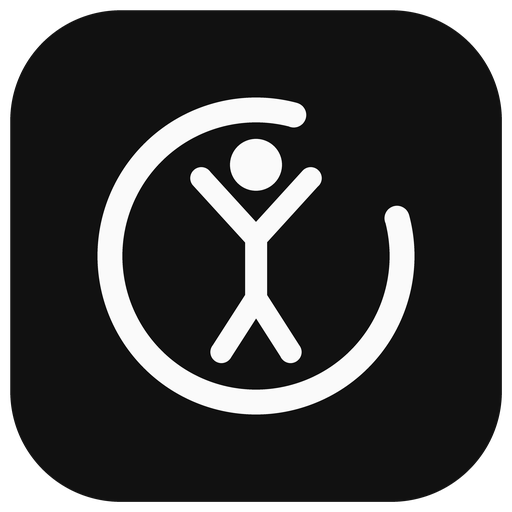

<p align="center">
  
</p>

<h1 align="center">Rep Flow</h1>

<p align="center">
  A minimal full-body workout app. One exercise per screen, a looping stick-figure demo, and rep counts you set yourself.
</p>

<p align="center">
  <a href="https://github.com/Squidly1408/rep_flow/actions/workflows/build.yml"></a>
  
  
  <a href="LICENSE"></a>
</p>

---

## Features

- **One screen per exercise** with a looping animation that shows the movement.
- **Tap to count.** Tap the big number to count off reps; at zero the app moves to the next exercise on its own.
- **Your numbers.** Set the reps for each exercise in Settings, or set one to 0 to skip it. Changes are saved on the device.
- **Light and dark** themes that follow the system.

## Install

Builds come from GitHub Actions on every push to `main`. Tagged versions (`v*`) also attach them to a [release](https://github.com/Squidly1408/rep_flow/releases).

### iPhone (IPA)

The IPA is **unsigned**, so you sideload it and it is signed with your own Apple ID:

1. Download `RepFlow.ipa` from the latest release, or from the `RepFlow-ipa` artifact of the latest [Build run](https://github.com/Squidly1408/rep_flow/actions/workflows/build.yml).
2. Install it with [Sideloadly](https://sideloadly.io) or [AltStore](https://altstore.io).
3. On the phone, trust your Apple ID under **Settings → General → VPN & Device Management**.

With a free Apple ID the app must be re-signed every 7 days.

### Android (APK)

Download `RepFlow.apk` from the release or the `RepFlow-apk` artifact and open it on the phone.

## Run from source

```bash
git clone https://github.com/Squidly1408/rep_flow.git
cd rep_flow
flutter pub get
flutter run
```

Check before pushing:

```bash
flutter analyze
flutter test
```

Building for iOS needs a Mac with Xcode. On Windows or Linux, push to GitHub and let the workflow build it.

## Project layout

| Path | What it holds |
|---|---|
| `lib/models/exercise.dart` | The routine: names, tips, default reps, tempo and the two key poses for each exercise |
| `lib/widgets/exercise_figure.dart` | The stick-figure animation (`CustomPainter`) |
| `lib/services/settings_store.dart` | Rep counts for each exercise, saved with `shared_preferences` |
| `lib/screens/` | Home, workout, settings and completion screens |
| `tool/generate_icons.py` | Draws the logo and writes the app icons for every platform |
| `.github/workflows/build.yml` | Analyze, test, and build the IPA and APK |

### Adding an exercise

Add another `Exercise(...)` to the list in `exercise.dart` with a `start` and an `end` pose. Joint positions run from 0 to 1, and the floor is at y ≈ 0.955.

### Changing the icon

Edit the drawing in `tool/generate_icons.py`, then run it from the repo root (needs Pillow):

```bash
python tool/generate_icons.py
```

## License

[MIT](LICENSE)
